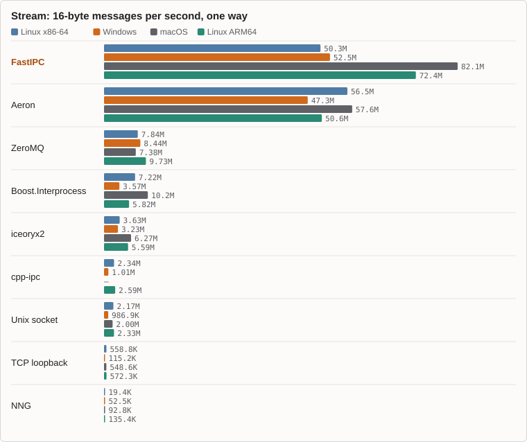
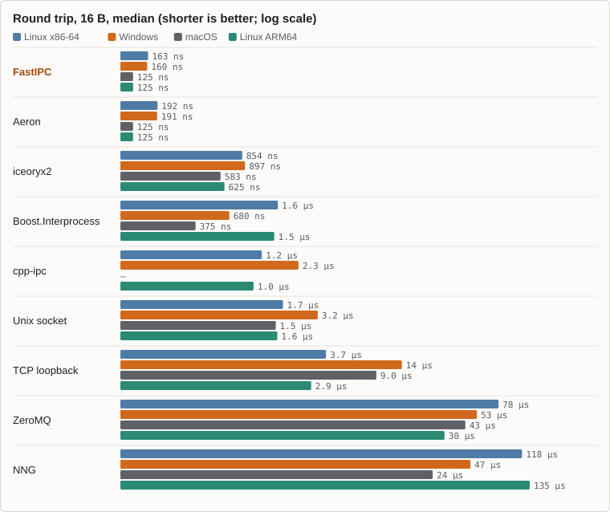
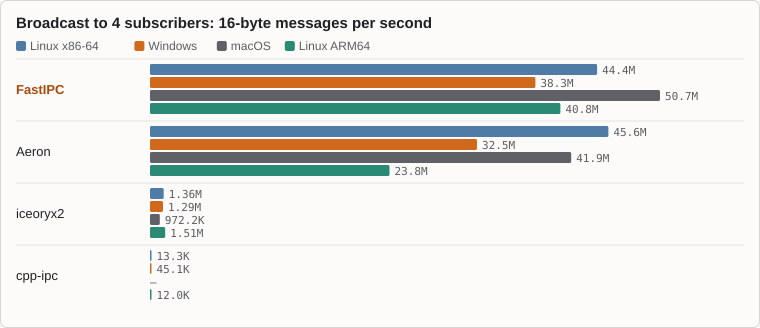
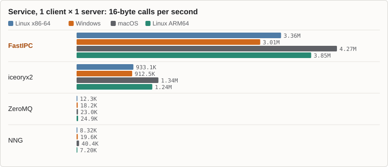

<p align="center">
  <picture>
    <source media="(prefers-color-scheme: dark)" srcset="website/assets/brand/fastipc-logo-dark.svg">
    
  </picture>
</p>

<p align="center"><b>Website, guides and benchmarks: <a href="https://fastipc.github.io/fastipc/">fastipc.github.io/fastipc</a></b></p>

# FastIPC

[](LICENSE)
[](CHANGELOG.md)
[](https://ziglang.org/download/)
[](docs/platform-support.md)
[](https://fastipc.github.io/fastipc/)

**Shared-memory IPC between processes, in any language.** FastIPC sends messages between processes on the same
machine through memory both of them map: a small Zig library with a C API of 30 functions
([`include/fipc.h`](include/fipc.h)), a header-only C++20 wrapper, a native Zig module, and bindings for Python, C#,
Java, Rust, Lua, JavaScript and Go. Every one speaks the same protocol, so a process in one language talks to a process
in any other.

It is for local processes that need to talk fast: an editor and a game, a UI and its engine, a Python front end and a
native service. It gives you four kinds of connection:

- A **stream** connects one server and one client at a time.
- A **broadcast** (pub/sub) connects one publisher to up to 1,024 subscribers.
- A **work queue** shares messages out among producers and consumers.
- A **service** carries requests from clients to a pool of servers, and the replies back.

## Head to head

FastIPC against the fastest of seven other IPC libraries (iceoryx2, Aeron, ZeroMQ, NNG, Boost.Interprocess, cpp-ipc
and the OS's sockets), each in its best configuration, on the same machines.

<!-- generated:readme-hero -->

FastIPC is the fastest, or level with the fastest, in 28 of the 30 measurements of the performance page's [case-by-case table](https://fastipc.github.io/fastipc/performance.html#cases); Aeron leads the other 2.

| Case | Linux x86-64 | Windows | macOS | Linux ARM64 |
|---|---:|---:|---:|---:|
| Round trip, 16 B <sub>latency (ns, median)</sub> | **1.18×** vs Aeron | **1.19×** vs Aeron | 1.00× vs Aeron | 1.00× vs Aeron |
| Stream, 16 B <sub>throughput (messages/s)</sub> | 0.89×\* vs Aeron | **1.11×** vs Aeron | **1.42×** vs Aeron | **1.43×** vs Aeron |
| Stream, 1 KiB <sub>throughput (messages/s)</sub> | **1.54×** vs Aeron | **1.32×** vs Aeron | **1.14×** vs Aeron | **1.11×** vs Aeron |
| Broadcast to 4 <sub>throughput (messages/s)</sub> | 0.98×\* vs Aeron | **1.18×** vs Aeron | **1.21×** vs Aeron | **1.71×** vs Aeron |
| Work queue 4 × 4 <sub>throughput (messages/s)</sub> | **1.89×** vs ZeroMQ | **2.04×** vs ZeroMQ | **5.71×** vs ZeroMQ | — |
| Service calls <sub>throughput (calls/s)</sub> | **3.60×** vs iceoryx2 | **3.30×** vs iceoryx2 | **3.18×** vs iceoryx2 | **3.10×** vs iceoryx2 |

<!-- /generated:readme-hero -->

Each cell is FastIPC's rate divided by the fastest other library's rate, with that library named; for the round trip,
the other library's time divided by FastIPC's. Above 1×, FastIPC is faster. A dash means the case needs more processes
than the VM's 4 vCPUs can run. \* In every benchmark Aeron's receiver polls in a loop and never sleeps, which keeps a
core 100% busy ([Aeron in detail](https://fastipc.github.io/fastipc/performance.html#aeron-note)).

<p align="center">
  
  
</p>

<details>
<summary>Broadcast and service charts</summary>
<p align="center">
  
  
</p>
</details>

Intel Core i9-13900H laptop (Windows 11, and Linux in WSL2) and Apple M1 MacBook Air (macOS, and Linux in a VM);
medians of 3 runs, no CPU pinning. [The performance page](https://fastipc.github.io/fastipc/performance.html) has every
case, the work queues, the method and each library's configuration, and
[`bench/alternatives`](bench/alternatives/README.md) reruns it all.

## Why FastIPC

- **Fast where it counts.** A 16-byte round trip between two processes takes 125 to 163 ns, and no library compared
  was faster. Service calls run over 3 times as fast as with iceoryx2, and a work queue up to 5.7 times as fast as with
  ZeroMQ.
- **Four patterns in one library.** Of the libraries above, only FastIPC has streams, broadcasts, work queues and
  services with replies, all in shared memory.
- **Any language on the other end.** C, C++, Zig, Python, C#, Java, Rust, Lua, JavaScript and Go, from one native
  library. Every pair of languages is tested against each other.
- **Knows when the other side dies.** Each side learns at once when its peer exits, crashes or closes, with no
  heartbeat or timeout, and a crash leaves nothing to clean up.
- **Safe against a broken peer.** Nothing in shared memory is trusted: a corrupt peer can make a call fail, but never
  crash or hang it. A fuzz harness checks it.
- **Small, with no dependencies.** About 8,000 lines of Zig, linking only the operating system's own libraries.

## Install

| Language | Get it | Docs |
|---|---|---|
| Python 3.9+ | `pip install fipc-python` ([PyPI](https://pypi.org/project/fipc-python/)), then `import fipc` | [`bindings/python`](bindings/python/README.md) |
| C# (.NET Standard 2.1) | `dotnet add package Fipc` ([NuGet](https://www.nuget.org/packages/Fipc)), namespace `FastIpc` | [`bindings/csharp`](bindings/csharp/README.md) |
| Java 22+ | `implementation("io.github.fastipc:fipc:1.0.0")` ([Maven Central](https://central.sonatype.com/artifact/io.github.fastipc/fipc)), module and package `io.github.fastipc` | [`bindings/java`](bindings/java/README.md) |
| Rust 1.85+ | `cargo add fipc` ([crates.io](https://crates.io/crates/fipc)), then `use fipc` | [`bindings/rust`](bindings/rust/README.md) |
| LuaJIT 2.1 | `luarocks install fipc` ([LuaRocks](https://luarocks.org/modules/fastipc/fipc)), then `require("fipc")` | [`bindings/lua`](bindings/lua/README.md) |
| JavaScript (Node.js 22+, Bun, Deno 2) | `npm install fipc` ([npm](https://www.npmjs.com/package/fipc)), then `import { createStream, connectStream } from "fipc"` | [`bindings/js`](bindings/js/README.md) |
| Go 1.27+ | `go get github.com/fastipc/fastipc/bindings/go/fipc@latest` ([pkg.go.dev](https://pkg.go.dev/github.com/fastipc/fastipc/bindings/go/fipc)), then `import "github.com/fastipc/fastipc/bindings/go/fipc"` | [`bindings/go`](bindings/go/README.md) |
| C / C++ | The Zig build system (recommended): `zig fetch --save git+https://github.com/fastipc/fastipc`, then link the artifact `fastipc` ([below](#c-and-c)); or, with any compiler, the [GitHub release](https://github.com/fastipc/fastipc/releases/latest)'s archive per OS (headers and library, with `fastipc.lib` on Windows) | [`include/fipc.h`](include/fipc.h), [`include/fipc.hpp`](include/fipc.hpp) |
| Zig 0.17.0 | `zig fetch --save git+https://github.com/fastipc/fastipc`, then import the module `fastipc` ([below](#zig)) | [`src/zig/root.zig`](src/zig/root.zig) |

The Python wheels, the NuGet package, the Maven artifact, the crate `fipc-sys`, the Lua rock, the npm package and the Go module bundle the
native library for Windows x64, Linux x64 and ARM64 (glibc 2.34+) and macOS on Apple Silicon (14.4+).

On macOS the library, `libfastipc.dylib`, is ad hoc signed and not notarized. Packages installed with pip, NuGet,
Maven, Cargo, LuaRocks, npm or Go need nothing more. If a browser downloaded the C/C++ archive
(`fastipc-<version>-osx-arm64.tar.gz`), macOS quarantines it. Clear the flag after unpacking with
`xattr -d com.apple.quarantine lib/libfastipc.dylib`. An app signed with the hardened runtime and library validation
has to sign the dylib it embeds with its own identity.

### C and C++

The recommended way to build C and C++ against FastIPC is the [Zig build system](https://ziglang.org/learn/build-system/).
Zig 0.17.0 is a single download and takes the place of CMake or any other build tool. It builds the library for your
target and compiles your C and C++ with its bundled Clang (`zig cc`, `zig c++`). After
`zig fetch --save git+https://github.com/fastipc/fastipc`, add this to your `build.zig`:

```zig
// build.zig
const fastipc = b.dependency("fipc", .{ .target = target, .optimize = optimize }).artifact("fastipc");
exe.root_module.linkLibrary(fastipc); // the shared library; fipc.h and fipc.hpp on the include path
exe.root_module.addCMacro("FASTIPC_SHARED", "1"); // Windows: the functions are dllimport
b.installArtifact(fastipc); // fastipc.dll next to the programs, libfastipc.so / .dylib in zig-out/lib
```

[`examples/c-cpp`](examples/c-cpp) is a project set up this way, with the C and C++ servers and clients shown below.

With another compiler, take the headers and the library from the GitHub release archive for your OS, or from
`zig build` in a checkout (`zig-out/include`, `zig-out/lib`, `zig-out/bin`). Put the headers on the include path and
link the library:

- Linux: `libfastipc.so`, found at run time through an rpath or `LD_LIBRARY_PATH`.
- macOS: `libfastipc.dylib`. Its install name is `@rpath/libfastipc.dylib`, so set an rpath such as
  `@loader_path/../lib`, or use `DYLD_LIBRARY_PATH`.
- Windows: `fastipc.lib`, with `fastipc.dll` next to the program and `FASTIPC_SHARED` defined.

`fipc.hpp` needs C++20.

## Examples

Each language has a server file and a client file. Run the server in one process, then the client in another. A
server listens on a name and accepts one client at a time, and a client connects to that name. All the examples make
the same exchange: the client sends `ping` and the server answers `PING`. A client in any language therefore works with
a server in any other. The repository's interop test, `python devtool.py test interop`, runs every server below
against every client (10 × 10 pairs, each in two processes) on Linux, Windows and macOS.

Timeouts are in milliseconds, where 0 doesn't wait and -1 waits forever. Some languages use their own types instead.
C++ takes a `std::chrono` duration, Java a `Duration`, Rust an `Option<Duration>` and Go a `time.Duration`. Zig takes a
`std.Io.Timeout`, where `.none` waits forever and a `.duration` or a `.deadline` bounds the wait.

### Python

```python
# server.py
import fipc

# rings of 1 MiB each way
with fipc.stream_create("my_channel", 1 << 20) as listener:
    with listener.accept() as conn:  # waits for a client
        message = conn.recv()
        conn.send(message.upper())
```

```python
# client.py
import fipc

with fipc.stream_connect("my_channel", timeout_ms=5000) as conn:
    conn.send(b"ping")
    print(conn.recv())  # b'PING'
```

These are the files in [`examples/python`](examples/python). Run `python server.py` there, then `python client.py` in
another terminal. Every call blocks by default (`timeout_ms=FOREVER`) and raises `FipcError` for any result other
than OK.

### C#

```csharp
// Server/Program.cs
using System.Text;
using FastIpc;

// rings of 1 MiB each way; Accept waits for a client
using var listener = FipcStream.Create("my_channel", 1 << 20);
using var conn = listener.Accept();
if (conn.Receive(out byte[] message) == FipcResult.Ok)
{
    string upper = Encoding.UTF8.GetString(message)
        .ToUpperInvariant();
    conn.Send(Encoding.UTF8.GetBytes(upper));
}
```

```csharp
// Client/Program.cs
using System.Text;
using FastIpc;

// waits up to 5 s for the server, else throws
using var conn = FipcStream.Connect("my_channel", 5000);
conn.Send("ping"u8);
conn.Receive(out byte[] reply);
Console.WriteLine(Encoding.UTF8.GetString(reply));  // PING
```

Each is a console project (`dotnet new console`) that uses the `Fipc` package. [`examples/csharp`](examples/csharp)
has both, with a reference to the binding's project instead of the package. Every call returns a `FipcResult`, so a
timeout or the peer's end comes back as a result rather than an exception.

### Java

```java
// Server.java
import io.github.fastipc.Connection;
import io.github.fastipc.Fipc;
import io.github.fastipc.Listener;

public class Server {
    public static void main(String[] args) {
        // rings of 1 MiB each way; accept() waits for a client
        try (Listener listener =
                 Fipc.createStream("my_channel", 1 << 20);
             Connection conn = listener.accept()) {
            String text = new String(conn.receive());
            conn.send(text.toUpperCase().getBytes());
        }
    }
}
```

```java
// Client.java
import io.github.fastipc.Connection;
import io.github.fastipc.Fipc;
import java.time.Duration;

public class Client {
    public static void main(String[] args) {
        try (Connection conn = Fipc.connectStream("my_channel",
                 Duration.ofSeconds(5))) {
            conn.send("ping".getBytes());
            byte[] reply = conn.receive();
            System.out.println(new String(reply));  // PING
        }
    }
}
```

These are in [`examples/java`](examples/java). Run each with the jar on the class path, for example
`java --enable-native-access=ALL-UNNAMED -cp fipc-1.0.0.jar Server.java` (Java 22+). A call that fails throws
`FipcException`, and its `result()` says why.

### Rust

```rust
// server.rs
fn main() -> fipc::Result<()> {
    let mut listener = fipc::stream::create("my_channel", 1 << 20)?; // rings of 1 MiB each way
    let mut conn = listener.accept(None)?; // waits for a client
    let message = conn.receive(None)?;
    conn.send(&message.to_ascii_uppercase(), None)?;
    Ok(())
}
```

```rust
// client.rs
use std::time::Duration;

fn main() -> fipc::Result<()> {
    let mut conn = fipc::stream::connect("my_channel", Duration::from_secs(5))?;
    conn.send(b"ping", None)?;
    println!("{}", String::from_utf8_lossy(&conn.receive(None)?)); // PING
    Ok(())
}
```

Each is a program of its own. In a checkout, run `cargo run --example server` and `cargo run --example client` in
`bindings/rust`. A call that fails returns an `Error` (`Error::Timeout`, `Error::Disconnected`, ...), and a timeout of
`None` waits as long as it takes. `cargo run` finds the native library. A program run on its own needs the library next
to it ([shipping](bindings/rust/README.md#shipping-your-program)).

### Lua

```lua
-- server.lua
local fipc = require("fipc")

local listener = assert(fipc.stream_create("my_channel", 1024 * 1024)) -- rings of 1 MiB each way
local conn = assert(listener:accept()) -- waits for a client
local message = assert(conn:recv())
assert(conn:send(message:upper()))
conn:close()
listener:close()
```

```lua
-- client.lua
local fipc = require("fipc")

local conn = assert(fipc.stream_connect("my_channel", 5000)) -- waits up to 5 s for the server
assert(conn:send("ping"))
print(assert(conn:recv())) -- PING
conn:close()
```

These are `examples/server.lua` and `examples/client.lua` in [`bindings/lua`](bindings/lua). Run
`luajit examples/server.lua` there, then `luajit examples/client.lua` in another terminal. The binding is a single
module on LuaJIT 2.1's FFI, with nothing to compile. Like Lua's `io` functions, a call that fails returns `nil` and the
error's name (`"timeout"`, `"disconnected"`, ...), so `assert()` raises it. A call without a timeout waits as long as
it takes.

### JavaScript

```js
// server.mjs
import { createStream } from "fipc";

const listener = createStream("my_channel", 1 << 20); // rings of 1 MiB each way
const conn = await listener.accept(); // waits for a client; the event loop runs meanwhile
const message = await conn.receive();
await conn.send(message.toString().toUpperCase());
conn.close();
listener.close();
```

```js
// client.mjs
import { connectStream } from "fipc";

const conn = await connectStream("my_channel", 5000); // waits up to 5 s for the server
await conn.send("ping");
console.log((await conn.receive()).toString()); // PING
conn.close();
```

These are `examples/server.mjs` and `examples/client.mjs` in [`bindings/js`](bindings/js). Run
`node examples/server.mjs` there, then `node examples/client.mjs` in another terminal (or use `bun`, or `deno run -A`).
The binding is one Node-API addon for Node.js 22+, Bun and Deno 2, with TypeScript types. A call that may wait returns
a Promise and leaves the event loop running. Its `Sync` form waits on the calling thread instead. A call that fails
rejects with a `FipcError` whose `code` names the result (`"FIPC_TIMEOUT"`, `"FIPC_DISCONNECTED"`, ...).

### Go

```go
// server.go
package main

import (
	"bytes"
	"log"

	"github.com/fastipc/fastipc/bindings/go/fipc"
)

func main() {
	listener, err := fipc.CreateStream("my_channel", 1<<20) // rings of 1 MiB each way
	if err != nil {
		log.Fatal(err)
	}
	defer listener.Close()
	conn, err := listener.Accept(fipc.Forever) // waits for a client
	if err != nil {
		log.Fatal(err)
	}
	defer conn.Close()
	message, err := conn.Receive(fipc.Forever)
	if err != nil {
		log.Fatal(err)
	}
	if err := conn.Send(bytes.ToUpper(message), fipc.Forever); err != nil {
		log.Fatal(err)
	}
}
```

```go
// client.go
package main

import (
	"fmt"
	"log"
	"time"

	"github.com/fastipc/fastipc/bindings/go/fipc"
)

func main() {
	conn, err := fipc.ConnectStream("my_channel", 5*time.Second) // waits up to 5 s for the server
	if err != nil {
		log.Fatal(err)
	}
	defer conn.Close()
	if err := conn.Send([]byte("ping"), fipc.Forever); err != nil {
		log.Fatal(err)
	}
	reply, err := conn.Receive(fipc.Forever)
	if err != nil {
		log.Fatal(err)
	}
	fmt.Println(string(reply)) // PING
}
```

These are `examples/server` and `examples/client` in [`bindings/go`](bindings/go). Run `go run ./examples/server`
there, then `go run ./examples/client` in another terminal. The binding is one package for Go 1.27+ and needs no cgo.
It loads the library through purego, its one dependency, so `CGO_ENABLED=0` builds and cross-compiling work. Every
method is safe to call from any goroutine. A call that fails returns an error you can test with `errors.Is`
(`fipc.ErrTimeout`, `fipc.ErrDisconnected`, ...). Timeouts are `time.Duration`s: `fipc.NoWait` doesn't wait and
`fipc.Forever` waits as long as it takes.

### C

```c
/* server.c */
#include <ctype.h>
#include <fipc.h>

int main(void)
{
    fipc_listener_t* listener;
    if (fipc_stream_create("my_channel", 1 << 20, &listener) != FIPC_OK) /* rings of 1 MiB each way */
        return 1;
    fipc_conn_t* conn;
    if (fipc_stream_accept(listener, &conn, FIPC_FOREVER) == FIPC_OK) /* waits for a client */
    {
        char buf[256];
        size_t len;
        if (fipc_recv(conn, buf, sizeof buf, &len, FIPC_FOREVER) == FIPC_OK)
        {
            for (size_t i = 0; i < len; i++)
                buf[i] = (char) toupper((unsigned char) buf[i]);
            fipc_send(conn, buf, len, FIPC_FOREVER);
        }
        fipc_close(conn);
    }
    fipc_listener_close(listener);
    return 0;
}
```

```c
/* client.c */
#include <fipc.h>
#include <stdio.h>

int main(void)
{
    fipc_conn_t* conn;
    fipc_result_t result = fipc_stream_connect("my_channel", &conn, 5000);
    if (result != FIPC_OK)
    {
        fprintf(stderr, "connect: %s\n", fipc_result_str(result));
        return 1;
    }
    char buf[256];
    size_t len;
    if (fipc_send(conn, "ping", 4, FIPC_FOREVER) == FIPC_OK
        && fipc_recv(conn, buf, sizeof buf, &len, FIPC_FOREVER) == FIPC_OK)
        printf("%.*s\n", (int) len, buf); /* PING */
    fipc_close(conn);
    return 0;
}
```

These are `c_server` and `c_client` in [`examples/c-cpp`](examples/c-cpp). Run `zig build` there, then
`zig-out/bin/c_server` and `zig-out/bin/c_client`. [C and C++](#c-and-c) explains how to use another compiler. The
header documents the contract of every call: results, timeouts, threads, messages in pieces and the peer's end.

### C++

```cpp
// server.cpp
#include <cctype>
#include <string>

#include <fipc.hpp>

int main()
{
    auto listener = fipc::stream_create("my_channel", 1 << 20);  // rings of 1 MiB each way
    if (!listener)
        return 1;
    auto conn = listener->accept();  // waits for a client
    if (!conn)
        return 1;
    std::string message;
    if (!conn->receive(message))
        return 1;
    for (char& c : message)
        c = static_cast<char>(std::toupper(static_cast<unsigned char>(c)));
    return conn->send(message) ? 0 : 1;
}
```

```cpp
// client.cpp
#include <chrono>
#include <cstdio>
#include <string>

#include <fipc.hpp>

int main()
{
    auto conn = fipc::stream_connect("my_channel", std::chrono::seconds(5));
    if (!conn)
    {
        std::fprintf(stderr, "connect: %s\n", conn.error().name());
        return 1;
    }
    std::string reply;
    if (!conn->send("ping") || !conn->receive(reply))
        return 1;
    std::printf("%s\n", reply.c_str());  // PING
    return 0;
}
```

[`include/fipc.hpp`](include/fipc.hpp) is a header-only C++20 layer over the C API. It adds no ABI and needs no
exceptions or RTTI. Every call returns a `fipc::result<T>` (or `fipc::status`) that converts to `true` on success, and
`error()` says why it failed (`fipc::errc::timeout`, `fipc::errc::disconnected`, ...). `fipc::listener`,
`fipc::connection`, `fipc::queue` and `fipc::service` are move-only and close when destroyed. Sends take a
`std::string_view` or a `std::span<const std::byte>`. Receives fill your buffer, and a `std::string` or `std::vector`
is resized to fit the message. Timeouts default to `fipc::forever`. The two programs are `cpp_server` and `cpp_client`
in [`examples/c-cpp`](examples/c-cpp).

### Zig

```zig
// build.zig, after `zig fetch --save git+https://github.com/fastipc/fastipc`
const fastipc = b.dependency("fipc", .{ .target = target, .optimize = optimize });
exe.root_module.addImport("fastipc", fastipc.module("fastipc"));
```

```zig
// server.zig
const std = @import("std");
const fastipc = @import("fastipc");

pub fn main(init: std.process.Init) !void {
    // rings of 1 MiB each way
    const listener = try fastipc.streamCreate(
        init.gpa,
        "my_channel",
        1 << 20,
    );
    defer listener.close();
    // waits for a client
    const conn = try listener.accept(.none);
    defer conn.close();

    var buf: [256]u8 = undefined;
    // .none: no timeout
    const len = try conn.recv(&buf, .none);
    const reply = std.ascii.upperString(&buf, buf[0..len]);
    try conn.send(reply, .none);
}
```

```zig
// client.zig
const std = @import("std");
const fastipc = @import("fastipc");

pub fn main(init: std.process.Init) !void {
    const five_s: std.Io.Timeout = .{ .duration = .{
        .raw = .fromSeconds(5),
        .clock = .awake,
    } };
    const conn = try fastipc.streamConnect(
        init.gpa,
        "my_channel",
        five_s,
    );
    defer conn.close();
    try conn.send("ping", .none);
    var buf: [256]u8 = undefined;
    const len = try conn.recv(&buf, .none);
    std.debug.print("{s}\n", .{buf[0..len]}); // PING
}
```

These are `zig_server` and `zig_client` in [`examples/zig`](examples/zig). Run `zig build` there, then
`zig-out/bin/zig_server` and `zig-out/bin/zig_client`. Like the C API, the native module runs on the library's own
threads. It has streams, broadcasts, work queues and services, with copied and zero-copy messages. The website's
[Zig page](https://fastipc.github.io/fastipc/zig.html) covers its error sets, timeouts, zero-copy calls and cancel.

## Features

- Each connection has its own shared segment, with one single-producer, single-consumer ring per direction. While both
  sides are busy, a message costs no system call. A waiting side spins briefly and then sleeps on a futex (Linux), an
  `os_sync` address wait (macOS) or an event (Windows), and the sender wakes it only if it is asleep.
- Messages can be any size. A message longer than the ring travels in pieces and arrives whole, copied straight into
  the caller's buffer. A message that fits in one piece can also be written and read in place (zero-copy). Nothing is
  allocated per message.
- A broadcast has one publisher and up to 1,024 subscribers, in any processes. Each message is stored once, in memory
  that every subscriber maps, and every subscriber sees the messages in the same order. A lossy subscriber never holds
  the publisher back, and is told it lost messages if it falls a full lap behind. A gated subscriber misses nothing and
  can read in place, but it is dropped if it holds the publisher back for too long.
- A work queue has up to 63 producers and 64 consumers, in any processes. Each message goes to one consumer, with no
  ordering guarantee. If that consumer's process ends before acknowledging the message, it goes to another consumer. A
  copying receive acknowledges before it returns. With an in-place receive, the release is the acknowledgement.
- A service has up to 64 clients and 64 servers, in any processes. Each request goes to one server, which replies to
  it. A client gets its replies in the order it sent its requests, so a request needs no id. A server waits for
  requests from every client in a single receive. Each request reserves room for its reply in its client's ring, so a
  server never waits for a client. If a server ends before replying, the request is answered with `FIPC_ABANDONED` and
  is never sent again.
- The owner of a broadcast, a queue or a service admits new members on one of the library's own threads. The owner
  needs no thread of its own for this, and can join from any thread.
- Each side learns at once when the other one ends. A local control connection (an abstract `AF_UNIX` socket on Linux,
  a named pipe on Windows, a socket file in the user's private directory on macOS) reports the end as soon as the
  peer's process exits, for any reason, or closes the connection. There is no heartbeat or timeout, and a crash leaves
  nothing to clean up. On macOS, a crashed owner's two files stay behind until the next create on that name removes
  them. They never get in the way.
- Nothing in shared memory is trusted. Every index and frame the peer wrote is checked before use. A corrupt peer can
  make a call fail with a result code, but it can't make it crash or hang. A fuzz harness checks this.
- The library has no third-party dependencies. It links only the operating system's own libraries: the C library on
  Linux and macOS, and system DLLs on Windows. Most bindings call it through their language's built-in
  foreign-function interface (P/Invoke, Java's FFM API, Rust's `extern "C"`, LuaJIT's FFI, Node-API). Python's binding
  uses CFFI, and Go's uses [purego](https://github.com/ebitengine/purego) so that it needs no cgo. A build downloads
  nothing. What it needs at build time, Zig's official translate-c package and the Node-API headers, is in
  [`vendor/`](vendor/README.md), and none of it ends up in the built library.
- The library is about 8,000 lines of Zig. That counts only what ends up in the binary, not comments, blank lines,
  tests or compile-time checks. The tests are about twice that size.
- The tests include unit tests and a C-API conformance suite that runs in one process and across processes, with peers
  killed at every step of the handshake. Both also run under ThreadSanitizer, and chaos, soak and fuzz harnesses
  complete the set.

## Performance

[Head to head](#head-to-head) compares FastIPC with the other libraries. FastIPC's own figures, for the C API, the
C++ wrapper and every binding, with the method and the run-to-run noise, are in
[`docs/perf/baseline.md`](docs/perf/baseline.md) and [`docs/perf/bindings-baseline.md`](docs/perf/bindings-baseline.md).

### Lowest latency

A receiver waiting in `fipc_recv` spins for 100-250 µs and then sleeps. A message that arrives after that wakes it in
tens of microseconds. For the lowest latency at any message rate, call `fipc_recv` (or `fipc_recv_acquire`) with
timeout 0 in a loop. A call that finds nothing makes no system call and reads no clock (about 50 ns on x86), and the
polling thread keeps one core at 100%. With one 32 B message per millisecond, the median time from send to receipt was
222 ns (Linux), 217 ns (Windows) and 83 ns (macOS) for a polling receiver, and 58 µs, 30 µs and 26 µs for a sleeping
one. On Linux and Windows the p99, 8-19 µs, is the time the OS takes the core away
([`docs/perf/baseline.md`](docs/perf/baseline.md)).

### Batches

`fipc_send_many` sends several messages in one call and publishes them together, waking the receivers at most once.
`fipc_recv_many` takes every message already waiting into one buffer, packed back to back. A stream of 16 B messages
with batches of 16 at both ends ran at 98M (Windows) and 108M (Linux) messages per second, against 45M with one message
per call. Batches of 64 reached 119M and 125M. These figures come from the harness in
[`bench/alternatives`](bench/alternatives/README.md), with 4 MiB rings. Batch both ends. If the sender batches and the
receiver takes one message per call, the stream runs slower than with no batching at all (28M), because the receiver
falls behind and the ring stays full.

The C++ wrapper (`send_many`, `receive_many`), the Zig module (`sendMany`, `recvMany`) and every binding have batch
calls: Python and Lua `send_many` and `recv_many`, C# and Go `SendMany` and `ReceiveMany`, Java and JavaScript
`sendMany` and `receiveMany`, Rust `send_many` and `receive_many`.

## Startup and restarts

- Either side can start first. A client's `fipc_stream_connect` waits for a server within its timeout, including
  while the server is busy with another client. With `FIPC_FOREVER` it waits however late the server starts.
  `fipc_broadcast_join`, `fipc_queue_join` and `fipc_service_join` also wait for the broadcast, the queue or the
  service to be created.
- When a server ends, its client gets `FIPC_DISCONNECTED`. The client closes its connection and connects again, and
  gets in once the restarted server accepts it.
- A stream serves one client at a time per name. The next client waits inside `fipc_stream_connect` until the server
  has closed its last connection and calls `fipc_stream_accept` again. For a pool of workers, use one stream (and one
  name) per worker, one work queue, or one service, whose servers answer requests from every client.
- `fipc_stream_accept` and `fipc_stream_connect` set up the connection on the threads that call them, and
  `fipc_stream_connect` returns once the server's `fipc_stream_accept` has offered the rings. A client and its server
  must therefore run on different threads, in one process or two. The owner of a broadcast, a queue or a service needs
  no thread for its joiners, and can join from the thread that created it.
- A server can poll for clients. Calling `fipc_stream_accept` with timeout 0 once per frame of a game loop lets a
  client in within two calls. A call that times out partway through a client's setup keeps that client for the next
  call.

## Platform support

FastIPC supports recent systems only ([`docs/platform-support.md`](docs/platform-support.md)):

- **Linux:** x86-64 (x86-64-v3, AVX2: Intel Haswell (2013), AMD Zen (2017) and later) and ARM64 (ARMv8.0-A: Raspberry
  Pi 3/4/5, AWS Graviton, Ampere, NVIDIA Jetson and later), glibc 2.34 or newer (Ubuntu 22.04, Debian 12, RHEL 9 and
  later).
- **Windows:** Windows 11, Windows Server 2022 and later, x64 (x86-64-v3).
- **macOS:** macOS 14.4 or newer, on Apple Silicon (M1 and later).

Not supported: 32-bit systems, Windows on ARM, Intel Macs, musl-based Linux, and x86-64 CPUs without AVX2. Both
processes of a connection must run as the same user (on Windows, also in the same desktop session).

## Build from source

You need [Zig 0.17.0](https://ziglang.org/download/) and Python 3.9+. Python runs `devtool.py`, which wraps the
build and creates its own `venv/` on first use. The bindings need their own toolchains:

- C#: the .NET 9 SDK, for the tests and benchmarks.
- Java: a JDK 17+ to run the Gradle wrapper. The build's JDK 25 is downloaded if none is installed.
- Rust: rustup. The binding's folder selects the stable toolchain.
- Lua: LuaJIT 2.1, and LuaRocks to package it.
- JavaScript: Node.js 22+. Bun and Deno run its tests too.
- Go: Go 1.27+.

```bash
git clone https://github.com/fastipc/fastipc && cd fastipc
python devtool.py build                 # Debug build (zig build): zig-out/lib, zig-out/bin, zig-out/include
python devtool.py build --release       # ReleaseFast
python devtool.py dist                  # the release libraries (Linux x64 and arm64, Windows, macOS) in zig-out/dist
python devtool.py package --smoke       # the wheel(s), the NuGet package, the Maven artifact, the crates, the Lua
                                        #   rock, the npm package and the Go module in zig-out/packages, installed
                                        #   and tried
```

Every build targets x86-64-v3 with PREFETCHW (on macOS, `apple_m1` and macOS 14.4; on ARM64 Linux, generic ARMv8.0-A) unless `zig build -Dcpu=...` names another CPU. `zig build cdb` writes a
`compile_commands.json` for clangd.

A receiver waiting on a stream checks the ring once, then not again until it has spun a set number of pauses. That
number was measured for each platform (`stream_paces` in `src/zig/core/wait.zig`, and
[the stream pace](docs/perf/baseline.md#the-stream-pace-on-x86) in the baseline). `zig build -Dstream_pace=N` builds
with another value for your hardware (1 turns the pacing off), and `python devtool.py bench-pace` measures a set of
values.

## Test

```bash
python devtool.py test fast             # unit tests, single-process C-API tests, the examples vs the docs (seconds)
python devtool.py test slow             # the multi-process C-API tests (minutes)
python devtool.py test all --filter end # fast, then slow; only tests whose name contains "end"
python devtool.py test chaos            # heavy, opt-in harnesses: peers killed, paused and restarted;
python devtool.py test soak             #   resources flat under churn;
python devtool.py test fuzz             #   a corrupt peer on the control connection and in the rings
python devtool.py test interop          # every language's server example against every language's client,
                                        #   every publisher example against every subscriber, every
                                        #   producer example against every consumer, and every service
                                        #   server example against every service client
                                        #   (needs every binding's toolchain; --skip-missing runs the rest)
python devtool.py bench zig-all         # the benchmark suite (bench/zig)
python devtool.py bench c-fastipc       # the C benchmark (bench/c; cpp-fastipc: the same loops through fipc.hpp)
python -m pytest bindings/python/tests                           # the Python tests (the repository's venv)
dotnet test tests/csharp/Fipc.IntegrationTests -c Release   # the C# integration tests
bindings/java/gradlew -p bindings/java test                       # the Java integration tests (JUnit 5)
(cd bindings/rust && cargo test)                                  # the Rust tests (unit, integration, doc tests)
(cd bindings/lua && luajit tests/run.lua)                         # the Lua tests (LuaJIT alone runs them)
(cd bindings/js && node --expose-gc --test)                       # the JavaScript tests (also: bun test)
(cd bindings/go && go test ./...)                                 # the Go tests (-race where cgo is available)
```

On Linux and macOS, `zig build test test-slow -Denable_tsan=true` runs both tiers under ThreadSanitizer.
[`CONTRIBUTING.md`](CONTRIBUTING.md) covers the test tiers, formatting and how to propose a change.

## Documentation

| Document | What |
|---|---|
| [The website](https://fastipc.github.io/fastipc/) | An overview, a quick start per language, and the benchmarks (its source: [`website/`](website/index.html)) |
| [`include/fipc.h`](include/fipc.h) | The API and its contract: results, timeouts, threads, messages, the peer's end, fork |
| [`docs/protocol.md`](docs/protocol.md) | The wire: names, control frames, the segment, ring frames, wake-ups (protocol version 1); broadcasts, work queues and services (the channel protocol, version 1) |
| [Architecture](https://fastipc.github.io/fastipc/architecture.html) | How the library is built: requirements, the data path of each kind, memory orderings, invariants, known limits, a code map and a reading order (its source: [`website/architecture.html`](website/architecture.html)) |
| [`docs/platform-support.md`](docs/platform-support.md) | Supported systems, and loading and unloading the library |
| [`docs/perf/baseline.md`](docs/perf/baseline.md) | The benchmark suite, its method and the reference numbers |
| [`tests/zig/README.md`](tests/zig/README.md) | The C-API test suite and how to add a test |
| [`CHANGELOG.md`](CHANGELOG.md), [`CONTRIBUTING.md`](CONTRIBUTING.md), [`SECURITY.md`](SECURITY.md) | Releases, contributing, reporting a vulnerability |

## Repository layout

| Path | What |
|---|---|
| `include/fipc.h`, `include/fipc.hpp` | The public C header, the whole API, and the header-only C++20 wrapper over it |
| `src/zig/` | The library: `c_api.zig` (the exports), `root.zig` (the native Zig API), `core/` (what every kind of connection shares: endpoints, the accept of a client, the admission of a broadcast's, a queue's and a service's joiners, the control connection and the watcher, the switch of the data calls on the kind, shared memory, the waits), `stream/` (SPSC connections: listener, server, client, frames, segment, rings, their waits, the data path), `broadcast/` (pub/sub: owner, subscriber, frames, segment, the publisher's and the subscribers' data paths), `queue/` (MPMC work queues: owner, member, frames, segment, producers, consumers, the returns), `service/` (request and reply: owner, member, frames, segment, clients, servers), `platform/` (Linux, Windows and macOS) |
| `bindings/` | The Python (CFFI) binding `fipc`, the C# binding `Fipc`, the Java (FFM) binding `io.github.fastipc`, the Rust crates `fipc` and `fipc-sys`, the Lua (LuaJIT FFI) rock `fipc`, the JavaScript (Node-API) npm package `fipc` and the Go module `github.com/fastipc/fastipc/bindings/go` (package `fipc`, without cgo), with their tests |
| `tests/` | The C-API suite (`zig`), the C++ wrapper's tests (`cpp`), the C# integration tests (`csharp`), and the chaos, soak and fuzz harnesses |
| `examples/` | The examples' servers and clients: downstream projects that depend on this repository, built with `zig build`, in C and C++ (`c-cpp`, no CMake) and Zig (`zig`); and the Python (`python`), C# (`csharp`) and Java (`java`) programs. The Rust, Lua, JavaScript and Go ones are in their bindings' `examples` folders |
| `bench/` | The benchmark suite (`bench/zig`), the C and C++ benchmark (`bench/c`), the Python, C#, Java, Rust, Lua, JavaScript and Go benchmarks, and the comparison with other IPC libraries (`bench/alternatives`) |
| `devtool.py`, `devtool_lib/` | The build, test, benchmark and packaging driver |
| `website/` | The project's website: static pages, no build step, published to GitHub Pages from `main` |
| `vendor/` | The build's one dependency, the official translate-c package, and Aro, which it uses ([`vendor/README.md`](vendor/README.md)): kept here so that no build downloads anything |

## License

MIT. Copyright (c) 2025-2026 Hayden Donnelly. See [LICENSE](LICENSE). The build-time packages in `vendor/` keep their
own licenses ([`vendor/README.md`](vendor/README.md)); the built library contains none of their code.
